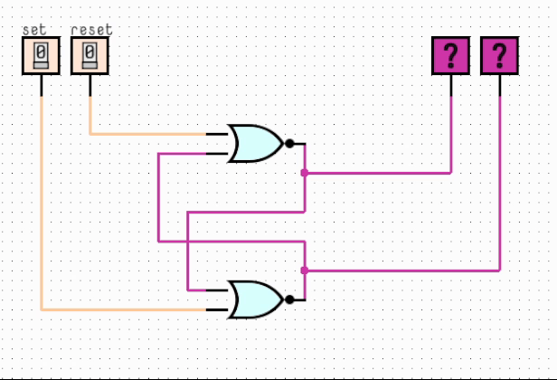

**An open-source suite for digital logic design, simulation and computer architecture exploration.**

SILICON combines a graphical circuit editor, an event-driven simulation kernel and Verilog interoperability in a single environment. It is designed for education, experimentation and the exploration of digital systems, from elementary logic gates to hierarchical circuits and processor architectures.

<p align="center">
   
</p>

[Website, downloads and documentation](https://giuliococconi.github.io/SILICON/) · [Releases](https://github.com/GiulioCocconi/SILICON/releases) · [Report an issue](https://github.com/GiulioCocconi/SILICON/issues)

_Currently supported by the [Bachelor's Degree programme in Electronic Engineering and Informaton tecnology @ The University of Genoa](https://corsi.unige.it/en/corsi/11911)_

_Package repository hosting is graciously provided by [Cloudsmith](https://cloudsmith.com).
Cloudsmith is the only fully hosted, cloud-native, universal package management solution, that
enables your organization to create, store and share packages in any format, to any place, with total
confidence._

## Features

### Circuit design

- Interactive schematic editor with configurable components and multi-bit buses.
- Combinational and sequential logic, including gates, arithmetic units, multiplexers, flip-flops, registers and ROMs.
- Hierarchical design through reusable subcircuits with named ports and customizable graphical symbols.
- Automatic component placement using OGDF and orthogonal wire routing using libavoid.

### Digital simulation

- Event-driven simulation with configurable propagation delays and delta-cycle semantics.
- Graph-based execution planning, strongly connected component decomposition and incremental evaluation of affected logic.
- Feedback-loop evaluation and staged updates for edge-triggered sequential components.
- Interactive signal manipulation and timed simulation, with unknown and error state handling.
- Waveform visualization, editable input stimuli, simulation replay and FST trace export.

### Verilog and Yosys interoperability

- Import Verilog designs through Yosys and convert supported netlists into editable graphical circuits.
- Export circuits to Verilog through the Yosys integration.
- Support for hierarchical and multi-module designs, with reusable circuit definitions.
- Integrated source editor with syntax highlighting.

### Computer architecture and project management

- SISL instruction set architecture descriptions, compilation and visualization.
- Binary document editing and file-backed ROM contents.
- Integrated workspace for circuit, source, architecture and binary documents.
- Versioned `.sil` project archives containing logic circuits, HDL code and binary files.

## Getting started

SILICON is available for Linux and Windows, and can also run directly in a browser through WebAssembly. Visit the [website](https://giuliococconi.github.io/SILICON/) for downloads, nightly builds, the online application and documentation.

SILICON is under active development; features and project file compatibility may evolve between versions. Some integrations depend on the platform and availability of external tools.

### Compiling on Linux

SILICON uses [Nix](https://nixos.org) and [CMake](https://cmake.org) in order to manage dependencies. It's recomended to use [Ninja Build](https://ninja-build.org) as a generator.

If you're not using NixOS as a distro, you can install Nix using the [official instructions](https://nixos.org/download.html),
however I personally recommend using [Lix](https://lix.systems/install), a modern Nix fork, which can be installed running the following command in a Linux system:

```shell
curl -sSf -L https://install.lix.systems/lix | sh -s -- install
```

Then enable the experimental features required by SILICON running:
```shell
echo "experimental-features = nix-command flakes" >> ~/.config/nix/nix.conf
```

Finally, run the commands below to compile the develop edition of SILICON on Linux:

```shell
git clone https://github.com/GiulioCocconi/SILICON
cd SILICON
nix build # Downloads the dependencies and builds the software
```

### Compiling on Windows

Only recent versions of the MinGW compiler are supported (tested using version `13.0`), you can install them via this [graphical installer](https://github.com/Vuniverse0/mingwInstaller/releases/tag/1.2.1).

The only thing you need to install for dependency management is [CMake](https://cmake.org), since the `CMakeLists` installs the dependency manager [vcpkg](https://vcpkg.io) automatically.
Since all dependencies are built from source, the first time you run CMake you might need to wait a few minutes (or hours, depending on your compute power).

To start the compilation process, once you have installed the compiler and CMake, run the following commands:
```shell
git clone https://github.com/GiulioCocconi/SILICON
cd SILICON
mkdir build
cmake -G "MinGW Makefiles" -Bbuild
make -C build
```

## Developing

### Using Linux (Nix)
```shell
git clone https://github.com/GiulioCocconi/SILICON
cd SILICON
nix develop   # It also installs the DDD debugger
mkdir build
cmake -G "Ninja" -Bbuild -DCMAKE_BUILD_TYPE=Debug
ninja -C build
```

### Using Windows
```shell
git clone https://github.com/GiulioCocconi/SILICON
cd SILICON
mkdir build
cmake -G "MinGW Makefiles" -Bbuild -DCMAKE_BUILD_TYPE=Debug
make -C build
```

## Documentation and contributing

- [User documentation and digital electronics lessons](https://giuliococconi.github.io/SILICON/)
- [C++ API reference](https://giuliococconi.github.io/SILICON/internaldocs/)
- [Contributing guidelines](./CONTRIBUTING.md)
- [Local build and test guide](./webpage/userdocs/guide/contributing/build.md)
- [Simulation and project internals](./webpage/userdocs/guide/internals.md)
