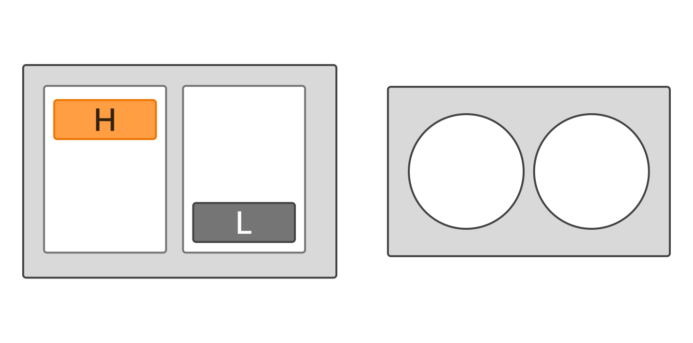

# Functions

## The Double Function

You're probably familiar with the concept of a mathematical function: a *rule* that assigns to every element of a set, called the **domain**, exactly one element of another set, called the **codomain**.

Let's consider the *double function*, which takes a natural number $n$ as input and returns twice its value as output.

We can define it mathematically as

$$
d:\mathbb{N}\to\mathbb{N},\qquad d(n)=2n.
$$

For example, $d(5)=10$.

Since the natural numbers form a **discrete set**, we can represent some of the function's input-output pairs in a table:

| $n$ | $d(n)$ |
|---|---|
| 0 | 0 |
| 1 | 2 |
| 2 | 4 |
| 3 | 6 |
| 4 | 8 |
| $\vdots$ | $\vdots$ |

However, since the domain $\mathbb{N}$ is infinite, we cannot list every input-output pair in a finite table. We need a general rule, such as $d(n)=2n$, to describe the entire function.

### Discrete and Continuous Domains

What if we defined the same function over the real numbers instead?

$$
d:\mathbb{R}\to\mathbb{R},\qquad d(x)=2x.
$$

Unlike the natural numbers, the real numbers form a **continuous domain**: they have no gaps, and fill the entire number line. As a consequence, between any two distinct real numbers there is always another real number.

We can still construct a table:

| $x$ | $d(x)$ |
|---|---|
| 0 | 0 |
| 0.0001 | 0.0002 |
| 0.0002 | 0.0004 |
| 0.0003 | 0.0006 |
| $\vdots$ | $\vdots$ |

But now, even between two consecutive entries, there are infinitely many possible input values.

We can visualize the difference by plotting the two functions.

<!-- TODO: the plot referenced above is missing. Add the figure for d(n) (isolated points) and d(x) (continuous line) here. -->

<text color="secondary" italic>For natural numbers, the graph consists of isolated points. For real numbers, the graph is a continuous line.</text>

The distinction is important: **neither function can be completely represented by a finite table**, because both domains are infinite.

What if, instead, we considered functions whose domain contains only a finite number of elements?

## Boolean Functions

In digital electronics, we are particularly interested in functions whose inputs and outputs can take only two values: **0** and **1**.

Let's define the set

$$
B:=\{0,1\}.
$$

We could equivalently represent these values as *False* and *True*. These are called **Boolean values**, in honor of George Boole, the English mathematician whose work laid the foundations of Boolean algebra.

A Boolean function with $n$ inputs and $m$ outputs can be written as

$$
\boxed{f:B^n\to B^m}
$$

where:

- $n$ is the number of input variables.
- $m$ is the number of output variables.
- $B^n$ represents all possible combinations of $n$ Boolean values.

For example, consider a function with two inputs and one output:

$$
f:B^2\to B.
$$

Since each input can independently take one of two values, there are exactly $2^2=4$ possible input combinations.

Unlike our previous examples, the domain is now **finite**. We can therefore represent the entire function using a table, called a **truth table**.

### Truth Tables

Let's consider a function that returns 1 only when both inputs are 1.

| $a$ | $b$ | $f(a,b)$ |
|---|---|---|
| 0 | 0 | 0 |
| 0 | 1 | 0 |
| 1 | 0 | 0 |
| 1 | 1 | 1 |

This table describes the function completely: there are no other possible input combinations.

More generally, a Boolean function with $n$ inputs has

$$
2^n
$$

possible input combinations, so its truth table contains exactly $2^n$ rows.

Each output can independently take either value, so for a single output, the number of possible functions becomes $2^{(2^n)}$.

| Number of inputs | Possible input combinations | Single-output functions |
|---|---|---|
| 1 | 2 | 4 |
| 2 | 4 | 16 |
| 3 | 8 | 256 |
| 4 | 16 | 65,536 |
| 5 | 32 | 4,294,967,296 |

Even with only a few inputs, the number of possible functions grows remarkably fast.

Fortunately, we don't need to study all these functions individually: every one of them can be built from a handful of simple building blocks, as we'll see shortly.

## A Practical Example: A Security Door

Let's consider a practical problem.

Imagine a security system protecting a door. The system has two switches used to enter a binary access code and a proximity sensor that detects whether someone is approaching.

The system must behave according to the following specification:

1. If the correct access code is entered, the alarm is disarmed.
2. If the access code is incorrect, the alarm is armed.
3. The siren sounds only when the alarm is armed and the proximity sensor detects someone.

Our goal is to design a system that satisfies these requirements.

### From Specification to Truth Table

First, we need to identify the inputs and outputs.

The system has three Boolean inputs:

- $a$: the first bit of the access code.
- $b$: the second bit of the access code.
- $s$: the proximity sensor, which is 1 when someone is detected.

It also has one Boolean output:

- $y$: the siren, which is 1 when it should sound.

We can therefore model the system as a function

$$
f:B^3\to B.
$$

Let's assume that the correct access code is **10**, meaning $a=1$ and $b=0$.

Since there are three inputs, there are $2^3=8$ possible input combinations.

We can construct the truth table directly from the specification, listing the input combinations in binary counting order:

| $a$ | $b$ | $s$ | $y$ |
|---|---|---|---|
| 0 | 0 | 0 | 0 |
| 0 | 0 | 1 | 1 |
| 0 | 1 | 0 | 0 |
| 0 | 1 | 1 | 1 |
| 1 | 0 | 0 | 0 |
| 1 | 0 | 1 | 0 |
| 1 | 1 | 0 | 0 |
| 1 | 1 | 1 | 1 |

Notice that when $s=0$, the siren never sounds, regardless of the access code.

When $s=1$, the siren sounds for every combination except the correct code, 10.

We have now described the entire behavior of our security system without specifying anything about its internal implementation.

But how can we actually build it?

## Elementary Boolean Functions

We've seen that the behavior of our security system can be completely described by a Boolean function.

However, describing a function through its truth table becomes increasingly impractical as the number of inputs grows. Even a function with just ten inputs requires $2^{10}=1024$ rows!

Wouldn't it be convenient to express Boolean functions using mathematical formulas, just as we did with the double function?

To do so, we first need to introduce some elementary Boolean functions.

### NOT: Logical Negation

Let's start with the simplest nontrivial Boolean function:

$$
\neg:B\to B.
$$

The **NOT function**, also called *logical negation*, returns the opposite of its input.

| $a$ | $\neg a$ |
|---|---|
| 0 | 1 |
| 1 | 0 |

In other words, NOT exchanges the two Boolean values:

$$
\neg 0=1,\qquad \neg 1=0.
$$

### AND: Logical Conjunction

The **AND function**, also called *logical conjunction*, takes two Boolean values and returns 1 only when both are 1.

$$
\land:B^2\to B.
$$

Its truth table is:

| $a$ | $b$ | $a\land b$ |
|---|---|---|
| 0 | 0 | 0 |
| 0 | 1 | 0 |
| 1 | 0 | 0 |
| 1 | 1 | 1 |

Notice that, for Boolean values, AND behaves exactly like ordinary multiplication:

$$
a\land b=ab.
$$

### OR: Logical Disjunction

The **OR function**, also called *logical disjunction*, returns 1 when at least one of its inputs is 1.

$$
\lor:B^2\to B.
$$

Its truth table is:

| $a$ | $b$ | $a\lor b$ |
|---|---|---|
| 0 | 0 | 0 |
| 0 | 1 | 1 |
| 1 | 0 | 1 |
| 1 | 1 | 1 |

Notice that OR also returns 1 when both inputs are 1. This is called *inclusive OR*.

Be careful: unlike AND, OR is **not** ordinary addition. In ordinary arithmetic $1+1=2$, but $B$ contains no such value: $1\lor 1=1$.

### Combining Boolean Functions

Just like ordinary mathematical functions, Boolean functions can be **composed** to obtain new functions.

As in ordinary algebra, we use a precedence convention to avoid excessive parentheses: NOT binds most tightly, then AND, then OR. For example, $a\lor b\land\neg c$ means $a\lor\bigl(b\land(\neg c)\bigr)$. We use parentheses whenever we want a different grouping, or simply for clarity.

Consider, for example,

$$
f(a,b)=a\land\neg b.
$$

To calculate its value, we first evaluate $\neg b$ and then apply AND to $a$ and the result.

| $a$ | $b$ | $\neg b$ | $f(a,b)$ |
|---|---|---|---|
| 0 | 0 | 1 | 0 |
| 0 | 1 | 0 | 0 |
| 1 | 0 | 1 | 1 |
| 1 | 1 | 0 | 0 |

The resulting function returns 1 only when $a=1$ and $b=0$.

By combining elementary Boolean functions, we can describe much more complex behaviors without having to enumerate every possible input combination.

In fact, **every Boolean function can be expressed using only NOT, AND, and OR**. These three operations form what is called a *functionally complete set*.

This means that, no matter how complicated a Boolean function may be, we can always find an expression for it using these elementary operations. We'll see a systematic way to build such an expression directly from a truth table in a later lesson; for now, the security door will show the idea by intuition.

This set is not the only functionally complete one: for instance, NAND alone (or NOR alone) is also enough. We will meet these operations later.

## Back to Our Security Door

Now that we've introduced the elementary Boolean functions, let's return to our security system.

Recall its specification: the siren should sound when someone is detected by the proximity sensor and the access code is incorrect.

We already know its truth table. Our task is now to find a **Boolean expression** that describes the same behavior.

Instead of considering all eight input combinations at once, let's divide the problem into smaller parts.

1. **Checking the Access Code**: The correct access code is 10, meaning that $a=1$ and $b=0$. We need a function that returns 1 precisely when these two conditions are satisfied. The NOT function allows us to express the condition $b=0$ as $\neg b=1$. We can then use AND to require both conditions simultaneously:

    $$
    c:=a\land\neg b.
    $$

2. **Arming the Alarm**: According to our specification, the alarm is armed whenever the access code is incorrect. Since $c=1$ means that the code is correct, we simply need its negation:

    $$
    e:=\neg c.
    $$

3. **Sounding the Siren**: Finally, the siren should sound only when the alarm is armed and the proximity sensor detects someone. Both conditions must be true, so we use AND once again:

    $$
    y:=s\land e.
    $$

So the complete function is

$$
\boxed{y=s\land\neg(a\land\neg b)}.
$$

We've successfully described our entire security system with a single mathematical expression.

Notice how closely the expression follows the original specification: the siren sounds when the sensor detects someone **AND** the access code is **NOT** correct.

## Why Does This Matter?

We started with a problem described in ordinary language. We identified its inputs and outputs, defined its behavior through a truth table, and finally derived a mathematical expression describing the same function.

This process is called **modeling**: representing a real-world system through a mathematical model that captures the behavior we're interested in.

The resulting Boolean expression allows us to reason about the system without considering how it will eventually be implemented.

And there's another interesting consequence: **different Boolean expressions can describe exactly the same function**.

For example, the expression we derived for our siren can also be written as

$$
y=s\land(\neg a\lor b).
$$

Although these expressions look different, they produce exactly the same output for every possible input combination.

### Try It Yourself

Because the domain is finite, a truth table is itself a proof. Build the truth tables of $s\land\neg(a\land\neg b)$ and $s\land(\neg a\lor b)$, and compare their output columns row by row. Do they match in all eight rows?

How can we prove equivalence when the domain is too large for a table? And how can we systematically transform one expression into another? To answer these questions, we'll need to explore the mathematical rules governing Boolean operations.
