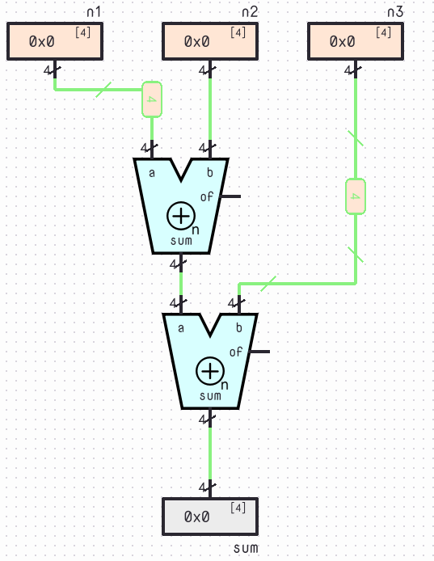

# Gates and Logic Circuits

## Where We Left Off

Lesson 3 gave us a complete pipeline on paper: from a specification to a truth table, from the truth table to a canonical formula, and from that formula to a simpler one. For the siren of our security door it ended with

$$
y=s\land(\neg a\lor b).
$$

This formula tells us **what** the alarm must compute. It doesn't tell us how to **build** something that computes it, and it hides a fact that every real circuit has to face: formulas are instantaneous, but physical circuits are not.

In this lesson we answer three questions:

1. **How can we turn a formula into a circuit, and how do we compare circuits that compute the same function?** We need a vocabulary of gates and a few measures of quality.
2. **How can we describe a circuit precisely enough for a computer to simulate it?** We need a language. We will use **Verilog**.
3. **How long does a circuit take to produce its answer?** We need a model of delay.

By the end, we will be able to go from a formula to a schematic, from a schematic to Verilog, and from either one to an estimate of its cost and speed. Verilog will be introduced a little at a time, as each new idea needs it.

## From Functions to Physical Circuits

The electronic circuits that deal with Boolean values are called **logic circuits**, and they can implement all sorts of functionalities. For example, the [TI CD74AC283](https://www.ti.com/product/CD74AC283) is a chip that adds two 4-bit binary numbers. Remember the abstraction principle: a system is made of abstract components, which are in turn made of components at a lower level. A circuit that adds *three* 4-bit numbers, for instance, can be assembled from two such adders.

{style="display:block;margin-inline:auto;zoom:0.7"}

How an adder works inside is the subject of the next lesson. For now what matters is the bottom of the hierarchy: since every Boolean function can be expressed with NOT, AND and OR (Lesson 3), it is enough to have physical circuits that implement those operations. Such circuits are called **logic gates**.

**A Boolean function specifies the behavior of a circuit, not necessarily its implementation.**

## The Gates

Each gate computes one elementary Boolean operation. Besides NOT, AND and OR, three more gates are especially important in practice.

**NAND** and **NOR** are the negations of AND and OR:

$$
\operatorname{NAND}(a,b)=\neg(a\land b),\qquad
\operatorname{NOR}(a,b)=\neg(a\lor b).
$$

**XOR** (*exclusive OR*) is 1 when its two inputs are different. Its complement, **XNOR**, is 1 when they are equal.

| $a$ | $b$ | NAND | NOR | XOR | XNOR |
|---|---|---|---|---|---|
| 0 | 0 | 1 | 1 | 0 | 1 |
| 0 | 1 | 1 | 0 | 1 | 0 |
| 1 | 0 | 1 | 0 | 1 | 0 |
| 1 | 1 | 0 | 0 | 0 | 1 |

XOR can be written with elementary operations:

$$
a\oplus b=\neg a\,b\lor a\,\neg b.
$$

**TODO: INSERT IMAGE** (the standard symbols of the seven gates, with the bubble on NAND, NOR, XNOR and NOT)

The last two columns of the next table preview the Verilog syntax that we will meet in a moment: every gate has an **operator** and a **primitive**.

| Gate | Formula | Verilog operator | Verilog primitive |
|---|---|---|---|
| NOT | $\neg a$ | `~a` | `not` |
| AND | $a\land b$ | `a & b` | `and` |
| OR | $a\lor b$ | `a \| b` | `or` |
| NAND | $\neg(a\land b)$ | `~(a & b)` | `nand` |
| NOR | $\neg(a\lor b)$ | `~(a \| b)` | `nor` |
| XOR | $a\oplus b$ | `a ^ b` | `xor` |
| XNOR | $\neg(a\oplus b)$ | `a ~^ b` | `xnor` |

### Universal Gates

NAND has a remarkable property: by itself, it is enough to implement **any Boolean function**. We only need to show that it can build NOT, AND and OR:

$$
\neg a=\operatorname{NAND}(a,a),\qquad
a\land b=\neg\operatorname{NAND}(a,b),\qquad
a\lor b=\operatorname{NAND}(\neg a,\neg b).
$$

*Proof.* Each identity follows from the rules of Lesson 3.

$$
\begin{aligned}
\operatorname{NAND}(a,a)&=\neg(aa)=\neg a && \text{(idempotency)}\\
\neg\operatorname{NAND}(a,b)&=\neg\neg(ab)=ab && \text{(double negation)}\\
\operatorname{NAND}(\neg a,\neg b)&=\neg(\neg a\,\neg b)=\neg\neg a\lor\neg\neg b=a\lor b && \text{(De Morgan, double negation)}
\end{aligned}
$$

The negations in the second and third lines can themselves be built from NAND gates, so every NOT/AND/OR circuit can be rebuilt using NAND alone. **NOR is universal too**, by the dual argument.

This matters because design is not only about finding an equivalent formula: we often must implement that formula with the gates a particular technology provides.

## From a Formula to a Schematic

Consider again the security door:

$$
y=s\land(\neg a\lor b).
$$

We convert the formula into a circuit by following its operations, one gate per operation:

$$
n=\neg a,\qquad t=n\lor b,\qquad y=s\land t.
$$

Each intermediate result is a **signal** carried by a wire.

**TODO: INSERT IMAGE** (schematic of the security door: a NOT gate feeding an OR gate together with $b$, whose output feeds an AND gate together with $s$)

| Signal | Function | Meaning |
|---|---|---|
| $n$ | $\neg a$ | Access code is not accepted |
| $t$ | $n\lor b$ | Alarm is armed |
| $y$ | $s\land t$ | Alarm is triggered |

For example, with $(a,b,s)=(1,0,1)$ we get $n=0$, $t=0$ and $y=0$. Even though the sensor detects someone, the alarm stays silent because the correct access code was entered.

### Reading a Schematic

The reverse operation is just as important: recovering a Boolean formula from a circuit. Start at the inputs, write the function computed by each gate, and continue until you reach the output.

A few conventions help:

1. **Wires can branch.** One output may feed several gate inputs. This is called **fan-out**.
2. **Outputs cannot simply be joined.** Connecting several ordinary gate outputs to the same wire creates a driver conflict, not a Boolean operation.
3. **Intermediate results can be reused.** If several expressions need $\neg a$, a single NOT gate can supply all of them.

The last convention will matter when we design circuits with several outputs.

## Describing Circuits in Verilog

Drawing schematics works for three gates, but not for three thousand. Engineers describe circuits in text, using a **hardware description language** (HDL). We will use **Verilog**, which is widely used in industry and supported by many free simulators.

A word of warning before we start: Verilog *looks* like a programming language, but it isn't one. A program is a list of instructions executed one after another. A Verilog description is a list of **components and connections**, and all of them exist and work at the same time.

### Modules and Ports

The basic unit of Verilog is the **module**, a box with named inputs and outputs, which are called **ports**. Here is the security door:

```verilog
module alarm(input a, input b, input s, output y);
  wire n, t;           // internal signals

  assign n = ~a;
  assign t = n | b;
  assign y = s & t;
endmodule
```

Line by line:

- `module alarm(...)` opens a module named `alarm`, and `endmodule` closes it. The port list says which ports are inputs and which are outputs.
- `wire n, t;` declares two internal signals. A `wire` is just a wire: it has no value of its own, it carries whatever drives it.
- `assign y = s & t;` is a **continuous assignment**: it says "this wire is permanently driven by this expression". It is not an instruction that runs once; it is a gate that is always there.
- `//` starts a comment, and every statement ends with a semicolon.

Compare the three `assign` lines with the three equations of the previous section: it is the same description, written down.

### Everything Happens at Once

Because each `assign` is a gate and not an instruction, **the order of the statements does not matter**. We could write the `y` line first and the circuit would be identical. And the intermediate signals are optional: we can nest the whole formula in a single line,

```verilog
module alarm(input a, input b, input s, output y);
  assign y = s & (~a | b);
endmodule
```

and the tool will build the same three gates. The operator table above shows the correspondence: $\neg$ becomes `~`, $\land$ becomes `&`, $\lor$ becomes `|`. As in Boolean algebra, parentheses group operations; when in doubt, add them.

### Gate Primitives

Verilog also has the gates themselves built in, as **primitives**. Here is the same circuit, written as a list of gates:

```verilog
module alarm(input a, input b, input s, output y);
  wire n, t;

  not g1(n, a);        // n = ~a
  or  g2(t, n, b);     // t = n | b
  and g3(y, s, t);     // y = s & t
endmodule
```

The **first** port of a primitive is always its output, followed by its inputs. The names `g1`, `g2`, `g3` are labels for the individual gates. Primitives with more inputs just take longer lists: `and g4(y, a, b, c);` is a three-input AND.

Both styles describe exactly the same circuit. The first, built from `assign` and operators, is better for describing *functions*; the second, built from primitives, is closer to a *schematic*. We will use whichever is clearer.

### Modules as Components

A module can be used inside another module, exactly as we assembled the three-number adder from two adders. Using a module this way is called **instantiating** it. Suppose a building has two security doors and one siren that sounds if either alarm triggers:

```verilog
module two_doors(input a1, b1, s1, a2, b2, s2, output siren);
  wire y1, y2;

  alarm door1(.a(a1), .b(b1), .s(s1), .y(y1));
  alarm door2(.a(a2), .b(b2), .s(s2), .y(y2));

  assign siren = y1 | y2;
endmodule
```

Each instance has a name (`door1`, `door2`), and the notation `.a(a1)` means "connect the port `a` of the instance to the signal `a1` of the enclosing module". Writing the port names explicitly makes the connections readable and hard to mix up. This is how the abstraction principle looks in code.

In the lab you will enter descriptions like these in SILICON and check them against the truth table.

## Combinational Circuits

The security door is a **combinational circuit**: a circuit whose settled outputs depend only on the current input values.

Mathematically, a combinational circuit with $n$ inputs and $m$ outputs implements a Boolean function

$$
f:\{0,1\}^n\rightarrow\{0,1\}^m.
$$

For the security door, $f(a,b,s)=s\land(\neg a\lor b)$. Whenever the inputs have the same values, the settled output has **always** the same value; in other words, the circuit has no state and no memory of its past.

Every circuit we build in this lesson, as a network of gates or as a set of `assign` statements, is combinational. This does not mean that the output changes instantaneously. Physical gates take time to respond, and we will study that carefully in a moment. But once all changes have propagated and the circuit has **settled**, the outputs are determined by the inputs.

::: tip An Important Distinction
A Boolean function describes the logical behavior of a combinational circuit, not its internal structure.

Several different circuits can implement the same function, and two circuits with identical truth tables may differ in gate count, delay and power consumption.
:::

## How Much Does a Circuit Cost?

Recall the three equivalent forms of the alarm function from Lesson 3.

Canonical sum of products:

$$
y=\neg a\,\neg b\,s\lor\neg a\,b\,s\lor a\,b\,s.
$$

Simplified:

$$
y=\neg a\,s\lor b\,s.
$$

Factored:

$$
y=s(\neg a\lor b).
$$

All three have the same truth table, but their implementations differ. Assume each NOT, AND or OR counts as one gate, gates may have three inputs, and complemented inputs are shared. Besides the **gate count**, we can count the **literals**, the variable occurrences in the formula, and the **logic depth**: the maximum number of gates along any path from an input to the output.

| Implementation | Gates | Literals | Depth |
|---|---|---|---|
| Canonical SOP | 6 | 9 | 3 |
| Simplified SOP | 4 | 4 | 3 |
| Factored | 3 | 3 | 3 |

The factored circuit needs half as many gates as the canonical one. This is why Boolean simplification matters: a simpler expression often leads to a cheaper circuit. Here all three have the same depth, but that is a coincidence of this small example. We will soon see circuits where cost and depth pull in opposite directions.

However, **gate count alone does not measure circuit quality**. Other considerations include:

- **Area:** how much hardware is required.
- **Delay:** how long the circuit takes to produce its result.
- **Power:** how much energy it consumes.
- **Fan-out:** how many inputs each output must drive.

The next section takes the second of these seriously.

## Delay: Circuits Take Time

Until now a gate computed its output "instantly". In reality, when an input of a gate changes, its output reacts only after a short time, called the **propagation delay** of the gate. A circuit is a network of gates, so the delays add up along the paths.

### A Simple Model

The simplest useful model is the **unit-delay model**: every gate has the same delay, which we call $\tau$. Then a signal that crosses $k$ gates arrives after $k\tau$.

Let's follow the factored alarm, $n=\neg a$, $t=n\lor b$, $y=s\land t$. Start from $(a,b,s)=(1,0,1)$, where $n=0$, $t=0$ and $y=0$, and let $a$ fall to 0. The correct final value is $y=1$. Here is how it gets there:

| Time | Event |
|---|---|
| $0$ | $a$ falls to 0 |
| $\tau$ | $n$ rises to 1 |
| $2\tau$ | $t$ rises to 1 |
| $3\tau$ | $y$ rises to 1 |

The change travels through the NOT, the OR and the AND, one gate at a time. Until $3\tau$ the output still shows the old value: the circuit hasn't "heard" the news yet.

### Critical Path

Not all input changes are equally slow. If instead $s$ rises while $t=1$, the output reacts after a single gate, $\tau$. If $b$ changes, it crosses two gates. Each input-to-output path has its own delay, equal to the sum of the delays of the gates on it:

$$
t_{pd}=\max_{\text{paths }P}\ \sum_{g\in P}\tau_g .
$$

The **propagation delay of the circuit**, $t_{pd}$, is the delay of its slowest path, called the **critical path**. After an input change, the output is guaranteed to have settled once $t_{pd}$ has passed. For the factored alarm, the critical path is $a\to n\to t\to y$ and

$$
t_{pd}=3\tau.
$$

In the unit-delay model this is just the logic depth times $\tau$, which is why depth is a good first measure of speed.

The fastest path matters too. The **contamination delay**, $t_{cd}$, is the delay of the *shortest* path (here, $\tau$, through $s$): before that time the output is guaranteed not to have started changing. Between $t_{cd}$ and $t_{pd}$ the output may show anything, so only after $t_{pd}$ can we trust it. This is what "settled" means.

Real gates are not all equal. A gate is slower with more inputs, a different technology, or a larger load, which means a larger fan-out. Still, the unit-delay model is enough to compare designs, and the formula above holds with any per-gate delays.

### Glitches

There is a subtler consequence of delay: while the circuit is settling, the output can do things that the truth table never mentions. Consider

$$
y=a\,b\lor\neg a\,c
$$

and set $b=c=1$. Then $y=a\lor\neg a=1$ by the complement rule, whatever $a$ does. Let $a$ fall from 1 to 0, with signals $n=\neg a$, $p=ab$, $q=nc$ and every gate taking $\tau$:

| Time | Event |
|---|---|
| $0$ | $a$ falls to 0 |
| $\tau$ | $n$ rises, $p$ falls |
| $2\tau$ | $q$ rises; $y$ falls, because $p$ is already 0 |
| $3\tau$ | $y$ rises, because $q$ is now 1 |

The output, which should have stayed at 1 throughout, dips to 0 for a time $\tau$. This temporary wrong value is called a **glitch**. The cause is that the two products see the change in $a$ at different times: one through the AND gate alone, the other through NOT and then AND.

There is a cure, and it is a rule that Lesson 3 mentioned without proving, the **consensus rule**: adding the redundant term $bc$ doesn't change the function, but it stays at 1 while $a$ changes, so it covers the gap:

$$
y=a\,b\lor\neg a\,c\lor b\,c .
$$

Notice the irony: this formula has *more* literals than the original, so it is "worse" by the measure of the previous section, yet it is a better circuit in this respect. Simplest isn't always best.

We will not study hazards in depth; the lesson to take away is the distinction between the **settled** output, which is what the Boolean function describes, and the **transient** output, which depends on delays. A glitch is harmless if nobody looks at the output before it settles.

## Two-Level and Multi-Level Logic

In Lesson 3 we saw that every Boolean function can be written as a **sum of products** (SOP). For example,

$$
y=ab\lor cd\lor ef
$$

has a natural implementation with a first layer of AND gates and a second layer containing one OR gate. This is **two-level logic**. The complementary form, *product of sums* (POS), gives an OR-AND circuit.

Since every function has an SOP form, every function can in principle be built with just two levels, provided gates with enough inputs are available. This regular structure is the principle behind the **Programmable Logic Array (PLA)**. Input inverters are not counted as levels here, and if only two-input gates exist, wide ANDs and ORs need extra levels.

But is two-level logic always the best choice?

### A Hard Case: Parity

Take three inputs $a,b,c$ and an output that is 1 whenever an odd number of inputs are 1. This function is **parity**:

$$
y=a\oplus b\oplus c.
$$

Its canonical SOP is

$$
y=\neg a\,\neg b\,c
\lor\neg a\,b\,\neg c
\lor a\,\neg b\,\neg c
\lor abc,
$$

with four product terms and twelve literals. No two minterms can be merged by the combining rule, because changing any single input flips the parity.

Yet the same function can be written as

$$
y=(a\oplus b)\oplus c,
$$

which needs only **two XOR gates**. The gap grows quickly:

| Inputs | SOP terms | Two-input XOR gates |
|---|---|---|
| 3 | 4 | 2 |
| 4 | 8 | 3 |
| 8 | 128 | 7 |
| 16 | 32,768 | 15 |

For $n$ inputs, the minimum SOP for parity has $2^{n-1}$ terms, while an XOR implementation needs only $n-1$ gates. Even if each XOR is expanded into elementary gates, the multi-level circuit wins for large $n$.

In Verilog, the XOR operator `^` does exactly this. For wide inputs we need **vectors**: `input [7:0] x` declares an 8-bit bus, `x[3]` selects one bit of it, and the **reduction operator** `^x` XORs all of its bits together:

```verilog
module parity8(input [7:0] x, output y);
  assign y = ^x;
endmodule
```

### Reducing the Depth

The XOR gates can also be arranged differently. For four inputs, a chain is

$$
y=((a\oplus b)\oplus c)\oplus d,
$$

and a balanced tree is

$$
y=(a\oplus b)\oplus(c\oplus d).
$$

Both use three two-input XOR gates, but their depths differ.

| Structure | XOR gates | Depth |
|---|---|---|
| Chain | 3 | 3 |
| Balanced tree | 3 | 2 |

In Verilog, the tree is a list of primitives in which the inner gates work in parallel:

```verilog
module parity4_tree(input a, b, c, d, output y);
  wire p, q;

  xor g1(p, a, b);     // these two gates work at the same time
  xor g2(q, c, d);
  xor g3(y, p, q);
endmodule
```

With $\tau_{xor}$ as the delay of one XOR, the chain needs $3\tau_{xor}$ to settle and the tree only $2\tau_{xor}$. For $n$ inputs, a chain has depth $n-1$, while a balanced tree has depth $\lceil\log_2 n\rceil$: for eight inputs, 7 against 3, and for sixteen, 15 against 4.

**An equivalent circuit may have a better structure even when it uses the same number of gates.** Keep the chain in mind: a signal that must cross one gate per bit makes delay grow with the size of the circuit, and we will meet that situation again very soon.

## Bubble Pushing

Boolean algebra also lets us transform circuits graphically. The small circle on a gate's input or output is a **bubble**, and it represents inversion. A NAND gate, for instance, is an AND gate with a bubble on its output.

**Bubble pushing** applies De Morgan's laws,

$$
\neg(a\land b)=\neg a\lor\neg b,\qquad
\neg(a\lor b)=\neg a\land\neg b,
$$

to move an inversion through a gate: AND becomes OR (or vice versa) and each input is inverted. Two consecutive inversions cancel: $\neg\neg a=a$.

### Example

Consider a NOR gate with inputs $A$ and $B$, followed by a NAND with $C$, followed by a NAND with $D$:

$$
n_1=\neg(A\lor B),\qquad
n_2=\neg(n_1C),\qquad
Y=\neg(n_2D).
$$

Applying De Morgan's law to the final NAND gives $Y=\neg n_2\lor\neg D$. Substituting $n_2$:

$$
Y=n_1C\lor\neg D,
$$

and finally

$$
\boxed{Y=\neg A\,\neg B\,C\lor\neg D}.
$$

Despite its tangled look, the circuit is just a simple sum of products. In Verilog the starting circuit reads:

```verilog
module tangled(input A, B, C, D, output Y);
  wire n1, n2;

  nor  g1(n1, A, B);
  nand g2(n2, n1, C);
  nand g3(Y, n2, D);
endmodule
```

### NAND-NAND Logic

Bubble pushing also explains why a sum of products can be built from two layers of NAND gates. Starting from

$$
y=ab\lor cd=\neg\bigl(\neg(ab)\land\neg(cd)\bigr),
$$

we obtain

$$
y=\operatorname{NAND}\bigl(\operatorname{NAND}(a,b),\operatorname{NAND}(c,d)\bigr).
$$

This is the standard way to implement SOP logic when the available library contains NAND gates.

## Circuits with Multiple Outputs

So far every circuit had one output, but a circuit can compute several functions at once.

Consider a **priority circuit** with inputs $A_3,A_2,A_1,A_0$. The highest active input has priority, and at most one of the four outputs can be 1.

| $A_3$ | $A_2$ | $A_1$ | $A_0$ | $Y_3$ | $Y_2$ | $Y_1$ | $Y_0$ |
|---|---|---|---|---|---|---|---|
| 0 | 0 | 0 | 0 | 0 | 0 | 0 | 0 |
| 0 | 0 | 0 | 1 | 0 | 0 | 0 | 1 |
| 0 | 0 | 1 | x | 0 | 0 | 1 | 0 |
| 0 | 1 | x | x | 0 | 1 | 0 | 0 |
| 1 | x | x | x | 1 | 0 | 0 | 0 |

Here `x` is a **don't-care**: either input value produces the same outputs. A row with don't-cares is a compact way of writing several rows at once, and the combining rule tells us what to do with them. For example, $Y_1$ is 1 in the rows $0010$ and $0011$:

$$
\neg A_3\,\neg A_2\,A_1\,\neg A_0\ \lor\ \neg A_3\,\neg A_2\,A_1\,A_0=\neg A_3\,\neg A_2\,A_1 .
$$

The variable $A_0$ simply disappears. Doing the same for each output gives

$$
\begin{aligned}
Y_3 &= A_3,\\
Y_2 &= \neg A_3\,A_2,\\
Y_1 &= \neg A_3\,\neg A_2\,A_1,\\
Y_0 &= \neg A_3\,\neg A_2\,\neg A_1\,A_0.
\end{aligned}
$$

*A warning about notation:* the `x` of a truth table means "I don't care", while Verilog also has an `x` value, which means "unknown". They look alike but they are different ideas.

The expressions share factors, so instead of recomputing them we define intermediate signals:

$$
h_2=\neg A_3,\qquad h_1=h_2\land\neg A_2,\qquad h_0=h_1\land\neg A_1,
$$

which gives

$$
Y_3=A_3,\quad Y_2=h_2A_2,\quad Y_1=h_1A_1,\quad Y_0=h_0A_0.
$$

In Verilog, the four inputs and the four outputs are natural candidates for vectors, and every `assign` is one gate of the circuit:

```verilog
module priority4(input [3:0] A, output [3:0] Y);
  wire h2, h1, h0;

  assign h2 = ~A[3];
  assign h1 = h2 & ~A[2];
  assign h0 = h1 & ~A[1];

  assign Y[3] = A[3];
  assign Y[2] = h2 & A[2];
  assign Y[1] = h1 & A[1];
  assign Y[0] = h0 & A[0];
endmodule
```

Sharing reduces the gate count, but it lengthens some paths: $Y_0$ now passes through the whole $h_2\to h_1\to h_0$ chain, and the shared signals have a larger fan-out. Without sharing, $Y_0$ would need only a NOT and a four-input AND, two levels. Cost and depth often pull in opposite directions.

The circuit is still combinational: its outputs depend only on the current inputs.

## Lab: Building Circuits in SILICON

Use one-bit inputs and outputs, and inspect intermediate signals whenever possible. SILICON accepts both schematics and Verilog descriptions. See [SILICON Basics](../guide/silicon.md) for the editor's general workflow.

### Experiment 1: The Security Door

Build the alarm function in three different ways.

**Canonical implementation**

$$
y=\neg a\,\neg b\,s\lor\neg a\,b\,s\lor a\,b\,s.
$$

**Factored implementation**

$$
y=s(\neg a\lor b).
$$

**NAND-only implementation**, using only two-input NAND gates:

$$
n_b=\operatorname{NAND}(b,b),\quad
t=\operatorname{NAND}(a,n_b),\quad
r=\operatorname{NAND}(s,t),\quad
y=\operatorname{NAND}(r,r).
$$

Connect all three circuits to the same inputs, with separate output indicators, and test every input combination.

| $a$ | $b$ | $s$ | Expected $y$ |
|---|---|---|---|
| 0 | 0 | 0 | 0 |
| 0 | 0 | 1 | 1 |
| 0 | 1 | 0 | 0 |
| 0 | 1 | 1 | 1 |
| 1 | 0 | 0 | 0 |
| 1 | 0 | 1 | 0 |
| 1 | 1 | 0 | 0 |
| 1 | 1 | 1 | 1 |

All three should produce the same settled output. Then compare their gate counts and logic depths. Which one has the longest critical path?

### Experiment 2: Parity

Build $y=a\oplus b\oplus c$ in two ways:

- The four-term canonical SOP.
- Two XOR gates in cascade.

Verify all eight input combinations. Then extend to four inputs and build both the chain $((a\oplus b)\oplus c)\oplus d$ and the balanced tree $(a\oplus b)\oplus(c\oplus d)$.

Do they always agree? Which has the smaller depth?

### Experiment 3: The Same Circuits in Verilog

Write the three versions of the alarm as three Verilog modules, `alarm_canon`, `alarm_fact` and `alarm_nand`. For the last one, start from this skeleton:

```verilog
module alarm_nand(input a, b, s, output y);
  wire nb, t, r;

  nand g1(nb, b, b);
  // complete with the other three gates
endmodule
```

Drive the three modules with the same inputs, test all eight combinations against the expected table, and check that they agree.

Then do the same for the parity circuits: write `parity4_chain` and `parity4_tree` and compare them.

## Why Does This Matter?

We can now extend the pipeline of Lesson 3 all the way to hardware, and every step is still mechanical:

1. **Specification** in ordinary language
2. **Truth table**, by identifying inputs and outputs
3. **Canonical formula**, with the SOP or POS algorithm
4. **Simplified formula**, with the rules of Boolean algebra
5. **Circuit**, one gate per operation, written as a schematic or as Verilog
6. **Evaluation**, by gate count, logic depth and critical path

Steps 5 and 6 are where Boolean algebra meets engineering. The same function can be implemented in many ways, and choosing among them means balancing cost, speed and the gates at hand. At the same time, Verilog puts us in the same position as a design tool: a precise textual description of a circuit that a program can simulate, check and eventually turn into real hardware.

### Looking Ahead

So far every signal in our circuits was a single bit. But the interesting data of the world, such as temperatures, positions and prices, are numbers, and a number needs many bits.

Here is a taste of what comes next. Add two one-bit numbers $a$ and $b$. The result can be 0, 1 or 2, so it needs two bits: a **sum** bit and a **carry** bit. The truth table gives

$$
\text{sum}=a\oplus b,\qquad \text{carry}=a\,b .
$$

That is a circuit with two outputs and two gates, which share their inputs, and we already know how to build it. Chaining such circuits to add numbers of any length is the subject of the next lesson, *Binary Numbers and Adders*. There, the chain-versus-tree idea of this lesson will come back: in an adder with many bits the carry has to cross one stage after another, and the delay grows with the number of bits.

## Try It Yourself

1. **Read a schematic.** A NOT gate inverts $c$. Its output and $a$ feed an AND gate, whose result is combined with $b$ using an OR gate. Write the final Boolean formula, then describe the circuit in Verilog with `assign` statements.

2. **Compare implementations.** Take the canonical SOP of the security door and its factored form. Compare their gate counts and depths. If every gate takes $\tau=1$ ns, what is $t_{pd}$ of each?

3. **Universal gates.** Show how to construct NOT, AND and OR using only NOR gates.

4. **XOR from NAND gates.** Verify that

   $$
   n=\operatorname{NAND}(a,b),\qquad
   y=\operatorname{NAND}\bigl(\operatorname{NAND}(a,n),\operatorname{NAND}(b,n)\bigr)
   $$

   implements XOR. What is the depth of this circuit?

5. **Balanced parity.** How many two-input XOR gates are needed for eight-input parity? Compare the depth of a chain with that of a balanced tree. If one XOR takes 2 ns, how long does each take to settle?

6. **Bubble pushing.** Find the sum of products computed by $\operatorname{NAND}\bigl(\operatorname{NAND}(a,b),\,\operatorname{NOR}(c,d)\bigr)$.

7. **Shared logic.** Count the gates needed for the priority circuit with and without the shared signals $h_2,h_1,h_0$. Which version has the greater depth for $Y_0$?

8. **Which path is it?** In the factored alarm with $\tau$ per gate, start from $(a,b,s)=(1,1,1)$ and let $b$ fall to 0. When does $y$ change? What if $s$ falls instead? Finally, start from $(0,1,1)$ and let $b$ fall. What happens to $y$, and why?

9. **Chase the glitch.** For $y=a\,b\lor\neg a\,c\lor b\,c$ with $b=c=1$, build the table of events when $a$ falls from 1 to 0, with every gate taking $\tau$. Does $y$ ever dip to 0? Compare with the circuit without the term $bc$.

10. **Priority in Verilog.** Enter `priority4` in SILICON and check all 16 input combinations. Then change the description so that `Y[0]` is computed with a single four-input `and` primitive, and verify that the behavior is the same.
